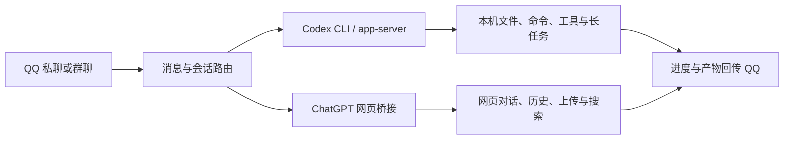

# ChatGPT 订阅、网页与 Codex 接入 QQ：开源项目调研

检索日：2026-10-29（America/Toronto）。范围：用户确认同时需要 ChatGPT 网页能力和 Codex 执行任务。

## TODO

- [x] 检索直接 QQ 桥接、综合机器人框架、订阅网关、网页会话桥接。
- [x] 查 OpenAI 官方订阅授权与功能边界。
- [x] 核对主要仓库 README、关键源码、维护记录。
- [x] 汇总专题报告与推荐组合。
- [x] 检查文档链接及证据边界。

本轮纯调研文档，免 TDD；验证采用官方文档、默认分支代码与 GitHub 元数据交叉检查。未安装、登录或运行候选项目。源码存在不等于已完成 QQ 端到端验证；默认分支能力不保证已进入最新稳定发行版。

## 先明确四种能力

| 路径 | 实际获得 | 不应推定获得 |
|---|---|---|
| Codex 原生 ChatGPT 登录 | 使用账号可用的 Codex 权益，运行本地 Agent | 自动同步 ChatGPT 网页聊天、全部网页工具 |
| 官方 Sign in with ChatGPT（SIWC） | OSS/本地应用经授权使用订阅的合格 Responses 请求 | 既有 ChatGPT 对话或其他账号上下文 |
| 网页会话自动化 | 操作登录浏览器中的 ChatGPT 页面；具体功能看适配实现 | 所有网页模式、生成附件和长任务都可靠可用 |
| 普通 OpenAI Platform API key | API 推理及对应 API 能力 | 自动抵扣 ChatGPT 订阅额度 |

官方依据：[Codex 认证](https://learn.chatgpt.com/docs/auth)、[SIWC 概览](https://developers.openai.com/siwc/token-sharing-open-source)。

SIWC 预览支持模型允许的文本、图片、文件输入，以及应用自己执行的 function/custom tools；网页搜索受模型与账号策略限制。当前不支持原生生图、file search、Code Interpreter、native computer use、hosted MCP/connectors 等；HTTP 对话历史由客户端携带。经 Codex app-server 可使用本地 shell/MCP 和本地 thread/resume。[官方限制](https://developers.openai.com/siwc/token-sharing-open-source/preview-limitations)、[app-server 接法](https://developers.openai.com/siwc/token-sharing-open-source/codex-app-server)。

官方当前说明 **ChatGPT Work 与 Codex 共享用量**。普通网页 Chat、Work、Codex 的功能表面仍不能混为一谈。[用量说明](https://learn.chatgpt.com/docs/pricing)。

## 1. cc-connect：最直接的 QQ → 本地 Codex 路线

仓库：[chenhg5/cc-connect](https://github.com/chenhg5/cc-connect)。Go。

- 接入 Codex、Claude Code、Gemini CLI 等已有 Agent。
- QQ 有两条实现：NapCat/OneBot 个人号，以及官方 QQ Bot API v2。
- 支持会话新建/切换、项目目录切换、模型与思考档位、权限模式、定时任务、图片与文件通道。
- 通过已有 Codex 登录使用相应权益，桥接层负责消息与控制；实际读写文件、运行命令由 Codex 完成。
- Codex 适配明确区分 `exec` 与 `app_server`。`exec` 没有交互审批 IPC；需要交互审批选 `app_server`。
- 适合：个人通过 QQ 管理本机项目；想尽快验证“发任务—看进度—收结果”。

证据：[README](https://github.com/chenhg5/cc-connect/blob/main/README.md)、[Codex adapter](https://github.com/chenhg5/cc-connect/blob/main/agent/codex/codex.go)、[OneBot adapter](https://github.com/chenhg5/cc-connect/blob/main/platform/qq/qq.go)、[官方 QQ adapter](https://github.com/chenhg5/cc-connect/blob/main/platform/qqbot/qqbot.go)。

关键差异：`docs/qq.md` 的旧表仍写图片只能接收；当前 `platform/qq/qq.go` 已有 `SendImage` 和 `SendFile`。据源码判断能力存在，具体发布版本及实际 QQ 文件传输仍待验证。

维护快照：最近 push 2026-10-27；最新稳定发行 [v1.5.0](https://github.com/chenhg5/cc-connect/releases/tag/v1.5.0)，2026-08-16。README 标 MIT，但本次默认分支根目录没有 LICENSE、元数据无 license；二次分发许可尚需确认。[元数据](https://api.github.com/repos/chenhg5/cc-connect)、[根目录](https://github.com/chenhg5/cc-connect)。

## 2. CodeX-to-QQ：QQ 专用工作台

仓库：[ankadada/CodeX-to-QQ](https://github.com/ankadada/CodeX-to-QQ)。Node.js，MIT。

- 使用独立官方 QQ Bot AppID/ClientSecret，支持私聊、群 @。
- 调用本机 Codex/Claude Code CLI；按聊天对象与 provider 隔离会话、工作目录。
- 实现任务进度、排队、停止、重试、恢复，工作线程重命名、固定、派生。
- 提供附件下载、文字提取、图片处理/可选 OCR；在 QQ 中看文件、diff、patch、Git 状态与导出 diff。
- 面向个人自托管。macOS/Linux 有常驻服务支持；README 明确 Windows 尚未正式支持。

适合参考 QQ 指令与任务交互设计；不作为当前 Windows 环境首选。最近 push 2026-03-11，仓库未归档。[README](https://github.com/ankadada/CodeX-to-QQ/blob/main/README.md)、[v0.2.3 提交](https://github.com/ankadada/CodeX-to-QQ/commit/979f922690397c9d3d0d685682d88726d3ed2b20)、[元数据](https://api.github.com/repos/ankadada/CodeX-to-QQ)。

## 3. CLIProxyAPI：订阅模型网关

仓库：[router-for-me/CLIProxyAPI](https://github.com/router-for-me/CLIProxyAPI)。Go，MIT。

- 通过 Codex OAuth 接入相应模型，提供 OpenAI/Responses 等兼容接口。
- 支持流式、工具调用协议、文本/图片输入、多账号路由和其他 provider。
- 可作为只接受兼容 API 的机器人框架的上游。
- **它负责模型请求，不负责 QQ，也不提供完整 Codex 执行循环或 ChatGPT 网页工具。** 工具调用结果仍需外部 Agent 执行。

当前 README 明确自 v6.10.0 不再内置用量统计，统计需独立组件，不能照旧教程承诺。[README](https://github.com/router-for-me/CLIProxyAPI/blob/main/README.md)。最新稳定 [v8.0.47](https://github.com/router-for-me/CLIProxyAPI/releases/tag/v8.0.47)，发布时间 2026-10-29 00:27 UTC；未归档，最近 push 2026-10-29 UTC。[元数据](https://api.github.com/repos/router-for-me/CLIProxyAPI)。

## 4. chatgpt-use：网页订阅与本地工作之间的桥

仓库：[leeguooooo/chatgpt-use](https://github.com/leeguooooo/chatgpt-use)。Rust，MIT，作者明确标实验性。

- `ask`：操作已登录 ChatGPT 网页，提问、附带本地文本上下文、获取回复；支持结构化返回与请求状态。
- `handoff`：把网页生成的计划/评审包交给 Codex 或 Claude Code 执行。
- `run`：通过网页文本协议驱动本地工具循环，仍为实验功能。
- `serve`：Anthropic 兼容入口，作者标 PoC，不能按稳定代理选型。
- `work` + MCP：让 ChatGPT 经连接器读写项目、运行命令，支持多轮继续；取决于账号/模型连接器能力与配置。
- 项目给 Windows 安装与 PowerShell 工具说明，依赖 chrome-use 和登录浏览器。没有现成 QQ 适配。

注意：`--mode research` 是任务提示模板，不能据此声称支持原生 Deep Research。`--file` 提供文本上下文，也不能自动等同全部网页附件上传能力。README 部分旧状态仍写 v0.0.2；实际 Cargo 与最新 release 是 v0.0.11，2026-10-09。[README](https://github.com/leeguooooo/chatgpt-use/blob/main/README.md)、[Cargo.toml](https://github.com/leeguooooo/chatgpt-use/blob/main/Cargo.toml)、[release](https://github.com/leeguooooo/chatgpt-use/releases/tag/v0.0.11)。

## 5. 官方 Codex：自行开发桥接时的执行核心

仓库：[openai/codex](https://github.com/openai/codex)，Apache-2.0。

app-server 提供认证、线程历史、审批、流式 Agent 事件；适合自定义 QQ 工作界面。CLI/SDK 适合任务执行。官方说明 app-server 的 WebSocket transport 仍实验性；本机集成可使用 stdio。[app-server 文档](https://learn.chatgpt.com/docs/app-server)、[开源 README](https://github.com/openai/codex/blob/main/README.md)。

它没有 QQ 适配；不能把“能驱动 Codex”写成“能完整远控当前桌面 App 的所有界面与聊天”。

## 历史教程排除项

[acheong08/ChatGPT](https://github.com/acheong08/ChatGPT)（常见 revChatGPT 依赖）已归档，最近 push 2023-08-02。旧 QQ/ChatGPT 教程依赖它时必须重新确认，不作为新项目主线。[元数据](https://api.github.com/repos/acheong08/ChatGPT)。

## 6. LangBot：优先验证的一体化候选

仓库：[langbot-app/LangBot](https://github.com/langbot-app/LangBot)，Apache-2.0。

- 原生适配官方 QQ API、OneBot v11；Web 管理、插件、知识库 RAG、MCP、多流水线与工作流。
- **OpenAI Codex provider** 已实现 ChatGPT 订阅授权、token 刷新、实际模型发现；解决模型推理入口。
- **CodexAgent Runner** 是另一条链：运行本机/SSH/daemon Codex CLI，支持会话续接、流式事件、工具、steering 和结构化交互。
- 二者不能混为一谈：只配置 provider 不代表已经运行了 Codex CLI。
- 适合同时做日常 QQ 对话、知识库、插件与管理员工作任务。

证据：[订阅说明](https://github.com/langbot-app/LangBot/blob/master/dev-docs/CODEX_SUBSCRIPTION.md)、[Codex Runner](https://github.com/langbot-app/LangBot/blob/master/plugins/Runner/codex-agent/README.md)、[QQ 平台文档](https://langbot.app/docs/en/usage/platforms/readme/)。最新 release [v4.11.2，2026-10-22](https://github.com/langbot-app/LangBot/releases/tag/v4.11.2)。

Runner 当前默认 full-access 与非交互审批，不应原样用于公开群。具体 QQ 审批卡片、文件和中断能力仍需验收，不能把通用 Runner 声明当成 QQ 全功能实测。

## 7. OpenClaw + 腾讯 QQ 插件：综合个人助手

仓库：[openclaw/openclaw](https://github.com/openclaw/openclaw)、[tencent-connect/openclaw-qqbot](https://github.com/tencent-connect/openclaw-qqbot)，均 MIT。

- QQ 官方机器人 API；私聊/群聊、多媒体、私聊流式、定时推送、会话与工具策略。
- OpenClaw 提供工具、记忆、调度和 Agent runtime；支持 Codex OAuth、SIWC 及 API key 路线。
- 可接原生 Codex app-server。原生 hosted plugins 还受 connector scope 与登录方式限制。
- QQ 频道能力弱于私聊/群聊，不能把所有媒体能力平移到频道。
- 适合长驻个人助手、定时提醒与跨工具任务。不是自动映射网页全部 Projects/Deep Research/Work 状态。

证据：[QQ 通道](https://docs.openclaw.ai/channels/qqbot)、[认证能力矩阵](https://docs.openclaw.ai/providers/openai/authentication)、[模型/runtime 路由](https://docs.openclaw.ai/providers/openai)。最新 release [v2026.10.8，2026-10-27](https://github.com/openclaw/openclaw/releases/tag/v2026.10.8)。

专项排除：其 **Agents API** runtime 虽有云端 shell、文件、搜索等工作能力，但当前明确只接受 Platform API key，不支持 ChatGPT 订阅认证；不能作为复用订阅的 Work 接口。[限制](https://docs.openclaw.ai/plugins/agentsapi#current-limitations)、[源码](https://github.com/openclaw/openclaw/blob/main/extensions/agentsapi/agentsapi-harness.ts)。

## 8. AstrBot + Codex 插件：聊天与工作显式分流

仓库：[AstrBotDevs/AstrBot](https://github.com/AstrBotDevs/AstrBot)，AGPL-3.0。

- 核心支持 QQ 官方/OneBot、插件、角色、知识库、MCP、Skills 与 Agent 环境。
- [Codex Router](https://github.com/qianan-qwq/astrbot_plugin_codex_router)（MIT）：管理员明确“用 Codex”才调用本机 CLI；异步运行、查询任务、完成后回原 QQ 会话，普通对话保持 AstrBot 路由。作者重点验证 Windows。
- [Codex OAuth 插件](https://github.com/RhoninSeiei/astrbot_plugin_codex_oauth_plug)：提供订阅模型、流式、看图、工具调用、搜索、额度查询；这是 provider 路线，不是本机 CLI 工作路线。
- 当前未确认 AstrBot 核心内建 Codex OAuth，不能把社区插件描述当核心已经提供。

适合已有 AstrBot 生态，或希望“普通聊一句；指定时才启动工作任务”。插件规模与维护证据见专题报告。核心最新 release [v4.29.3，2026-10-24](https://github.com/AstrBotDevs/AstrBot/releases/tag/v4.29.3)。

## 9. ChatGPT Web MCP：Windows 网页能力首选验证对象

仓库：[Goudu666/chatgpt-web-mcp](https://github.com/Goudu666/chatgpt-web-mcp)，Node.js，MIT。

- 独立持久浏览器 profile，经 MCP 操作真实 ChatGPT 页面，无须 API key。
- 新建/续接历史、上传文件、选择模型和思考档位、触发并校验原生网页搜索。
- 接口支持枚举/切换页面模式，源码描述含“聊天/工作”；不是仅靠提示词要求换模式。
- 有跨进程串行、限流与会话归档轮换；支持 Windows 常见 Chrome/Edge 路径。
- 尚未确认独立 Deep Research、完整 Work 工具链及生成产物下载。没有 QQ 适配。

证据：[README](https://github.com/Goudu666/chatgpt-web-mcp/blob/main/README.md)、[MCP 接口](https://github.com/Goudu666/chatgpt-web-mcp/blob/main/src/index.js)、[浏览器实现](https://github.com/Goudu666/chatgpt-web-mcp/blob/main/src/browser.js)。主线最新提交 [2026-09-20](https://github.com/Goudu666/chatgpt-web-mcp/commit/d6c1909151d9d13b439af1f519513ebee2267893)。

## 10. ChatGPT-Web2API：网页聊天转 REST/MCP

仓库：[Octo-Lex/ChatGPT-Web2API](https://github.com/Octo-Lex/ChatGPT-Web2API)，Python，MIT。

- 用浏览器 CDP 驱动 ChatGPT，对外提供 OpenAI-compatible `/v1/chat/completions` 与 MCP。
- MCP 涵盖 Projects、历史、记忆、Custom GPTs、项目文件列表；这些能力不会因为只配置 `base_url` 就自动出现在 QQ。
- 可用于偏 API 型的机器人框架；网页并发会话池为实验功能，默认关闭。
- 未确认附件上传、Deep Research 或完整 Agent/Work 专用接口；文件列表不等于文件上传。

证据：[README](https://github.com/Octo-Lex/ChatGPT-Web2API/blob/master/README.md)、[MCP 接口](https://github.com/Octo-Lex/ChatGPT-Web2API/blob/master/src/chatgpt_web2api/mcp_server.py)。默认分支最近提交 2026-07-12；仓库 push 为 2026-10-22，不能用后者冒充主线新功能日期。

## 其他值得知道的项目

| 项目 | 功能与定位 | 结论 |
|---|---|---|
| [Koishi + ChatLuna](https://github.com/ChatLunaLab/chatluna) | 多模型聊天、长期记忆、浏览/Agent、MCP、子 Agent、Computer 管理；靠 Koishi 适配 QQ | AGPL-3.0；未核到内建 ChatGPT 订阅 OAuth；适合 Koishi 生态 |
| [NapCatQQ](https://github.com/NapNeko/NapCatQQ) | NTQQ 个人号 → OneBot 消息/媒体/文件接口 | 连接层，不是 AI；[限制许可](https://github.com/NapNeko/NapCatQQ/blob/main/LICENSE)，不等同宽松开源 |
| [guilhermesilveira/chatgpt-mcp](https://github.com/guilhermesilveira/chatgpt-mcp) | 最小网页 MCP/HTTP/CLI，发消息、模型切换、停止 | 可参考；“支持长等待”不能当成已实现 Deep Research 入口 |
| [Microck/chatgpt-webui-mcp](https://github.com/Microck/chatgpt-webui-mcp) | 源码确实点击 Deep Research，后台 run_id 查询，网页生图与下载路径 | MIT；已归档，2026-04-26 后无主线更新，仅作为实现参考 |

具体证据：[框架专题](./qq-frameworks-2026-10-29.md)、[网页专题](./chatgpt-web-bridges-2026-10-29.md)。

## 推荐组合（尚未部署）

| 目标 | 优先验证 | 原因 |
|---|---|---|
| 尽快从 QQ 操作本机 Codex | cc-connect + Codex 原生登录 | 消息、会话与任务控制已具备，减少自研桥接 |
| 可扩展 QQ 对话/知识库/工作机器人 | LangBot + Codex provider / Codex Runner | 对话模型与工作执行均已有明确实现 |
| 长驻个人助手、调度和多工具 | OpenClaw + 腾讯 QQ 插件 | Agent 平台与官方 QQ 通道较完整 |
| 还要真实网页 ChatGPT | 上述主线 + ChatGPT Web MCP，或 chatgpt-use | 独立接入网页会话；不会误把模型推理视为网页能力 |
| 从零开发自己的开源产品 | 官方 SIWC + Codex app-server + QQ adapter | 官方订阅授权路线清晰；仍须自行完成 QQ 与任务状态层 |

建议先验证“两条后端，共用 QQ 入口”：

此图是建议架构，不是已经验证的端到端系统。没有找到本次可确证“一套即装即用、完整覆盖网页对话 + 原生 Deep Research/Agent/Work + Codex 执行 + QQ”的成熟项目。

## 开工前最小验证

1. QQ 私聊多轮与历史续接；群内会话不串线。
2. Codex 实际执行一次受限文件/命令任务，QQ 能回传进度、结果和失败。
3. 网页真实上传、搜索、指定模式；确认实际使用的账号/模型。
4. 生成文件能取回；长任务停止、超时、登录失效与重启恢复有明确状态。

本轮未进行以上运行验证。文件中的建议组合与未确认能力均保留此边界。
